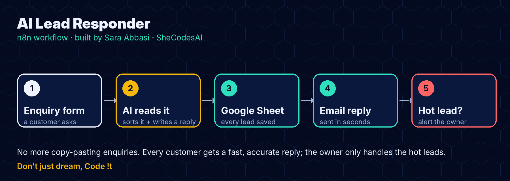

# AI Lead Responder (n8n + AI)

**Every enquiry gets a fast, accurate reply, every lead is saved, and the owner only handles the hot ones.**

▶ [Watch the 46-second demo](https://abbasisarah.github.io/assets/videos/demo-n8n-ai-lead-responder.mp4)



Small businesses lose customers because enquiries wait hours for an answer. This **n8n** workflow answers them in seconds:

1. A customer fills in the **enquiry form** (name, email, course, message).
2. **AI (Claude)** reads it, **sorts it** (Fees, Admission, Timings, Complaint…), marks it **high or normal priority**, and **writes a short, friendly reply**, using **only the business's real facts**. If the answer isn't in the facts, it says the team will reply personally. It never makes up prices or dates.
3. The lead is **saved to Google Sheets**.
4. The reply is **emailed to the customer** through Gmail.
5. **Hot leads** (ready to join, or upset) **alert the owner** straight away.

## Files
| File | What it is |
|---|---|
| `workflow.json` | **The n8n workflow.** Import it into n8n. |
| `simulate.py` | The same flow in Python, so you can see it work without n8n |
| `sample/enquiries.csv` | 6 example enquiries |
| `sample/leads.csv`, `sample/outbox/` | What the flow produced for them |
| `build_workflow.py` | Regenerates `workflow.json` |

## Result on the sample enquiries
```
Ayesha Khan     Fees         high    🔥 owner alerted     "fees kitni hai? I want to join next month"
Bilal Ahmed     Course info  normal                       "never coded before, is it okay for a beginner?"
Sana Malik      Timings      normal                       "Do you have weekend classes?"
Usman Tariq     Complaint    high    🔥 owner alerted     "not happy… I want a refund"
Hira Shah       Course info  normal                       "Can I study online from Lahore?"
Omar Farooq     Other        normal                       "Do you offer Java?" → team replies personally
```
*(Made with `simulate.py` in offline mode, where simple keyword rules stand in for the AI. With an API key, Claude does this step and writes more natural replies.)*

## Set it up in n8n (about 15 minutes)
1. In n8n: **Workflows → Import from file** → choose `workflow.json`.
2. **Settings** node: change the business name, your email (`owner_email`) and the **facts** the AI may use.
3. **Ask AI** node → Credential → **Header Auth**: Name `x-api-key`, Value = your Anthropic API key.
4. Create a Google Sheet with a tab called **Leads** and these headers in row 1:
   `date, name, email, course, message, category, priority, reply`
   Then, in the **Save lead to Sheet** node, connect your Google account and paste the Sheet URL.
5. **Reply to customer** and **Alert the owner**: connect your Gmail account.
6. Open the **Enquiry form** node, copy the form URL, send a test enquiry, then **Activate** the workflow.

## Run the Python version
```bash
python simulate.py                    # offline demo, no API key needed
ANTHROPIC_API_KEY=sk-... python simulate.py   # real AI replies
python -m pytest                      # 4 tests
```

## Adapt it for a client
- Use **WhatsApp, Telegram or Slack** instead of email for the owner alert
- Add the lead to a **CRM** (HubSpot, Airtable, Notion)
- Use a website **chat widget** or **Facebook/Instagram messages** instead of the form
- Use OpenAI or another model instead of Claude: only the **Ask AI** node changes

*Sunrise Tech Academy is a fictional demo business; all names and emails in the samples are made up.*

---
**Want an AI automation like this for your business?** Sara Abbasi · [abbasisarah.github.io/hire](https://abbasisarah.github.io/hire/) · [GitHub](https://github.com/AbbasiSarah) · Instagram [@shecodess.ai](https://www.instagram.com/shecodess.ai/)
